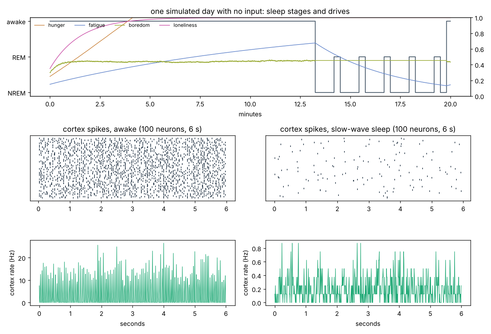
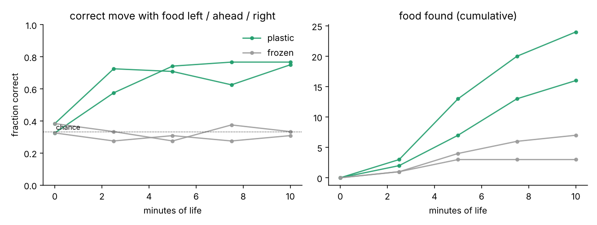
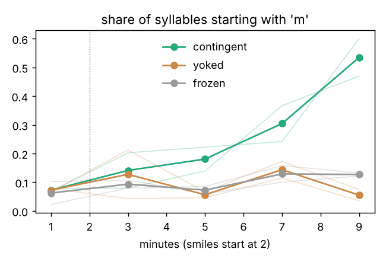
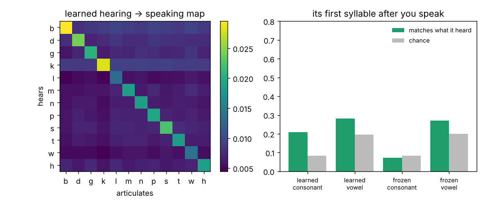
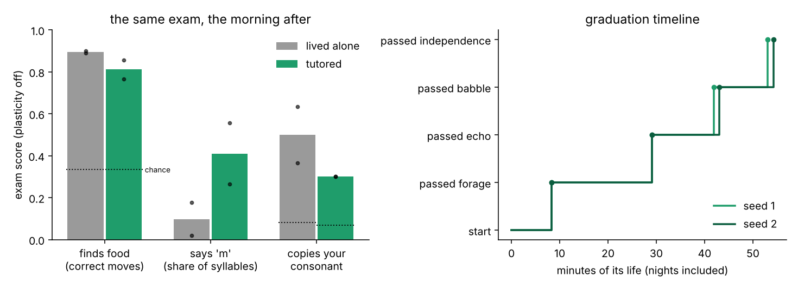
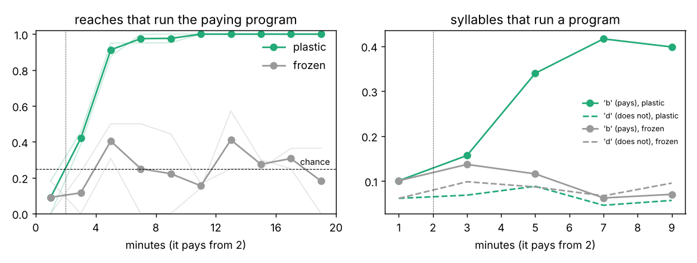
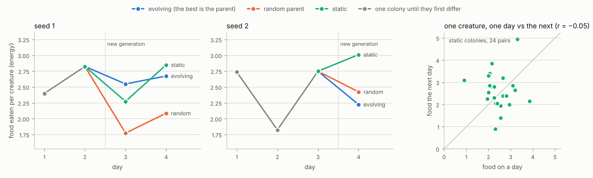

# anima

**A local framework for brain-like agents that live on their own clock.**

anima does not build a language model.  It builds a *spiking neural network*
— neurons with membrane potentials, synapses with conductances, learning by
local plasticity — and embeds it in what real brains are embedded in: drives
that build up, neuromodulators that change how the whole network computes,
a sleep/wake cycle, memory replay, and a body in a world.

Then it lets it run.  The network fires whether or not anyone is there.  The
creature gets hungry, bored, lonely and sleepy; it wanders, forages,
babbles, falls asleep, replays its day and wakes up.  **It never waits for a
prompt.**  Your text is not a request — it is turned into sound and heard,
phoneme by phoneme, while everything else keeps going.  What it does next is
whatever its dynamics produce.

```
$ anima chat
anima is alive (1667 spiking neurons, 07:11 awake). It does not wait for you: it will
babble, wander, get hungry, bored, lonely and sleepy on its own.
Talk to it whenever you like. /help for commands, /quit to leave.

anima › liwoli su   [07:15]
anima › tu   [07:18]
anima › le mutu   [07:23]
you › hello
anima › mu no sa lapi   [07:31]
anima › so   [07:38]
you › mama
anima › kahe ti ta   [07:45]
anima › gi   [07:50]
you › :)
anima › he   [07:54]
anima › gi   [07:58]
anima › tela hi   [08:06]
you › baba
anima › hihi   [08:09]
      (anima found food)
anima › lanu   [08:19]
you › /status
[08:20 awake] hunger 0.18 fatigue 0.22 boredom 0.36 loneliness 0.32 | DA 0.20 NE 0.35 ACh 0.80 5HT 0.51
anima › ba   [08:24]
      (anima found food)
anima › bu   [08:27]
you › /quit
saved anima_brain.npz — run again to continue its life.
```

That is a real session with a newborn creature; the only edits are removing
the terminal's prompt redraws, wrapping the first line and shortening the
save path.  The first three utterances happened before anyone said
anything.  The bracketed times are its own clock — one simulated day lasts
20 real minutes by default, so it gets sleepy about 13 minutes in.

It can also use programs you allow, by learning which of its acts make
them do something good for it; it keeps a log of its thoughts, read out of
its own brain activity; other programs can connect to it while it lives
([below](#programs-thoughts-and-other-programs)); and several creatures can
share an arena, compete for food or share a feast, and — when one of them
does clearly better — be followed by it and variations of it, chosen by a
genetic algorithm ([a colony](#a-colony-living-together-competing-cooperating-evolving)).  Everything runs locally on
a CPU with **NumPy as the only dependency** — or, with CuPy or PyTorch
installed, its spiking network can run on a GPU, which is meant for brains
several times larger than the default ([running on a GPU](#running-on-a-gpu);
not yet tried on real GPU hardware).

---

## Quick start

```bash
cd anima
python -m venv .venv && source .venv/bin/activate     # Windows: .venv\Scripts\activate
pip install -e .                                       # just numpy
anima chat                                             # talk to it (any terminal)
anima live                                             # live dashboard (macOS/Linux; Windows: pip install windows-curses)
```

`anima` and `python -m anima` are the same thing.  The creature is saved to
`anima_brain.npz` when you quit and resumed next time — same synapses, same
memories, same time of day.  `--new` starts a fresh one.

In the chat, type anything at any time.  `:)` or `*smile*` is approval and
`:(` disapproval (non-verbal, no sound).  `/status`, `/world`, `/stats`,
`/feed`, `/thoughts`, `/mind` (print its thoughts as they happen), `/tools`,
`/sleep`, `/wake`, `/save`, `/quit`.

The live dashboard shows the world, its drives and neuromodulators, the
activity of each region, a live raster of cortical spikes and the
conversation (in v0.3 with its thoughts in between, `/mind` hides them):

```
 anima  07:42   AWAKE     age    25.3s  1.0x realtime  1667 neurons  memories 14  replays 0

 world                                          drives
 +------------------------------------------+   hunger     ███████████······················· 0.33
 |                                          |   fatigue    ██████···························· 0.18
 |                                          |   boredom    ███████████······················· 0.31
 |                                          |   loneliness ████████████······················ 0.35
 |                                          |
 |                     .. .           *     |   neuromodulators
 |                     .. . . ..            |   dopamine   ████████·························· 0.22
 |                        *     .. .        |     phasic   █████████████████················· +0.02
 |                                  ..v     |   noradren.  ████████████████████·············· 0.59
 |                                     *    |   acetylch.  ████████████████████████████······ 0.82
 |                                          |   serotonin  █████████████████················· 0.51
 +------------------------------------------+
 doing: —        energy ███████···              activity (Hz)
 cortex spikes (10 neurons, last 6 s)           cortex   █▆▆▆▆▅▅▄▅▄▄▄▄▄▃▃▂▃▂▃▃▂▃▂▂▂▂▁▁▁▁    ▁   5.7
 |   | ||   |  || | | | ||| | |    |  |  |  |   senses   ▇▇▇▇▇▇▇▇▇▇▇▇▇▇▇▇▇▇▇▇▇▇▇▇▇▇▇▇▇▇▇▆▆▆▆▆   9.8
 |||  |    | | |  | |  | ||  |  |||  | |   ||   hearing  █▇▇▇▆▆▅▅▄▄▃▃▃▃▂▂▁▁▁▁▁▁             ▁   0.6
 ||| ||| |  || ||  | | || ||  | | ||  |   |||   motor    ▇▇▇▇▇▇▆▆▆▆▇▇▆█▆▆▆▆▆▆▆▆▆▆▆▆▆▇▆▆▇▆▆▆▆▆   8.9
    ||  ||  |  |  || | | ||  | ||   |  | ||||   voice    █▆▆▆▅▄▃▃▂▂▁▁▁      ▂▂▂▂▃▄▄▄▄▃▃▃▄▄▄▆▄   1.0
 |||| ||  || | | | | |||| || | | |    | |  |    interoc. ▆▆▆▅▆▅▅▅▅▅▅▅▅▆▅▅▆▆▅▅▅▆▆▆▆▆▆▇▇▇█▇▇▇▇▇   4.1
 || || |  | || |  | |  |  | |   | | | | |  ||
 || ||    | | |   | || || | |||| |||| | | ||
 |   |||    |||| | |  |  || |    | |  | | |||
 ||  | ||   ||  |   |  | |||    || | |   |  |
 || |||  ||    |  || | || |||  | | | || || ||

 conversation
     9.5  anima › le mutu
    14.8  anima › mu no sa
    17.4  anima › we
    20.2  you   › hello mama
    23.1  anima › ti welu toto
          anima is saying: si…
you ›                                                                 Enter: say  /save  /sleep  /wake
```

## Raising it with a local LLM (Ollama)

The brain is not a language model — but a language model can raise it.
`anima train` gives a local LLM, served by [Ollama](https://ollama.com), the
job of a parent or animal trainer, and takes the creature through four
lessons until it can look after itself:

```bash
ollama pull llama3.2      # once; any chat model works (qwen3, gemma3, mistral, ...)
anima tutor-check         # is Ollama up? does the model give usable decisions? how fast?
anima train               # up to 30 creature-minutes of lessons in real time; Ctrl-C any time
anima train               # later: the lessons continue where they stopped
anima live                # meet the result
```

No Ollama?  `anima train --teacher scripted` uses the built-in teacher.
Other machines: `--host gpu-box:11434` (or `OLLAMA_HOST`).  Reasoning models
are faster with `--think off`.  Once it has graduated, nobody needs to be
there: it forages, babbles and sleeps on its own.  In `anima chat` you can
still talk to it, smile at it, and `/feed` it.

A real session with the built-in scripted teacher, in two sittings (paths
shortened; long stretches cut at the "…"):

```
$ anima train --teacher scripted --minutes 8.5 --fast
teacher: scripted teacher (no LLM)
lesson 1 of 4: Find food — turn toward the smell of food and walk to it, without help
training for up to 8.5 creature-minutes as fast as the CPU allows; Ctrl-C stops (progress is saved)

   [07:11 forage] scripted: Let it practise; the guide keeps food within reach. → wait
      anima › susupe sape
      anima › ke
   [07:21 forage] scripted: Let it practise; the guide keeps food within reach. → wait
      anima › do ku
   …
   ✎ [13:34] exam 'forage': score 0.68 (chance 0.33; correct moves left 18/20, ahead 13/20, right 10/20)
   …
   ✎ [16:15] exam 'forage': score 0.67 (chance 0.33; correct moves left 16/20, ahead 12/20, right 12/20)
   …
$ anima train --teacher scripted --minutes 2 --fast      # later: it carries on where it stopped
resumed anima_brain.npz (age 510s of simulated life)
  schooling: in lesson 1 of 4 (forage)  [anima_brain.tutor.json]
   …
   ✎ [18:59] exam 'forage': score 0.77 (chance 0.33; correct moves left 19/20, ahead 11/20, right 16/20)
★ [18:59] graduated 'Find food': exam 0.77 (need 0.60; chance 0.33), food 1.8/min (need 1.0)
   ── lesson 2: Copy me — start its reply with the consonant it just heard
   [19:08 echo] scripted: Offer a new sound (n) to copy; the reflex praises a copy. → say 'no no'
      anima › si to wuwo
   [19:18 echo] scripted: Offer a new sound (t) to copy; the reflex praises a copy. → say 'te te'
      anima › ke tutu
```

With an LLM teacher the decision lines carry the model's name, its latency
and its own one-line thought instead of the script's.

**How it teaches.** Every ~8 seconds the model gets a short JSON report —
drives, energy, what the creature just said and did, its measured skills,
the lesson's goal, progress and tips — and answers with up to three actions:
say a syllable or two, smile, frown, give food (ahead/left/right/near),
switch a reflex rule on or off, go back to review an earlier lesson, or
leave itself a note.  It never touches a weight; all learning is still the
creature's own dopamine, spike timing and sleep.

Rewards only teach if they come within about a second of the behaviour (the
width of the eligibility traces), and a model takes seconds to think.  So
teaching runs at two speeds, as a human trainer's does with a clicker: the
LLM picks the strategy and the moments, and **reflex rules** running on the
creature's own 10 ms clock deliver the contingent part — a smile half a
second after an *m* syllable, food in front of it when it calls while
hungry, food within reach while it learns to forage, a smile when it copies
a sound.  The creature never waits for the model: a slow answer just means
fewer decisions.

| lesson | goal | reflexes | conditions | passed when (measured) |
|---|---|---|---|---|
| 1 forage | find food alone | `guide_food` | kept mildly hungry (energy ≤ 0.5) | two exams in a row: ≥ 60% correct moves with food held left / ahead / right (chance 33%); ≥ 1 meal/min |
| 2 echo | copy the sound it hears | `reward_echo` | a little hungry (≤ 0.6) | starts its reply with your consonant ≥ 1.8× as often as chance (and ≥ 15%) |
| 3 babble | make the target sound | `reward_syllable` | a little hungry (≤ 0.6) | ≥ 30% of its syllables start with *m* |
| 4 independence | live on its own | none | — | keeps its energy up (mean ≥ 0.35, never < 0.08) for 8 awake minutes, no help |

Each lesson also needs a minimum of awake practice, and its test has to keep
passing for a minute.  Exams are taken by a **clone** of the creature — same
synapses, plasticity off — so testing never interrupts or trains it; passed
skills get spot checks later, and the teacher can send it back to review.
A lesson still not passed after 45 awake minutes is left "not mastered" and
the curriculum moves on, so training never gets stuck.  `--with-ask` adds an
experimental fifth lesson, *ask for food* (say *m* when hungry: no food
grows, calls are answered with food and calls made when full with a frown) —
see the honest limits for why it is not in the default set.
Graduation is decided by these measurements, never by the model, and every
decision is validated first: unknown tools and rules are dropped, rules
from other lessons and free food in the "ask" lesson are refused (unless it
is starving), lessons can't be skipped, speech is reduced to letters.  If
the model is unreachable or answers nonsense, the scripted teacher covers
that turn (after three failures in a row the model gets a minute's rest).
Progress — lesson, measurements, exams, rules, the teacher's journal — is
saved to `anima_brain.tutor.json` next to the brain, so skills build up over
as many sessions as it takes.  The whole curriculum takes about an hour of
the creature's life, nights included.

From Python:

```python
from anima import Agent
from anima.tutor import OllamaTeacher, Tutor

agent = Agent.create()
tutor = Tutor(agent, OllamaTeacher(model="llama3.2"))
print(tutor.train(minutes=30))       # creature-minutes, in real time
```

`examples/04_llm_tutor.py` is a complete version; `anima/tutor/` has the
client (standard library only), reflexes, measurements, exams, curriculum
and teachers.  Lessons are data: pass `Tutor(..., curriculum=Curriculum([Lesson(...), ...]))`
to teach your own, and add reflexes to `anima.tutor.RULES`.  Results are in [section 5](#5-what-a-teacher-adds).

## Programs, thoughts, and other programs

### It can use programs — the ones you allow

It cannot type and has no words, so each program you allow is bound to
something it can *do*: say a syllable, or reach with one of its hands (an
optional extra motor area).  The program's answer comes back as
consequences it can feel — a sound, food in front of it, a treat or a
buzzer — and it learns which programs are worth using the way it learns
everything else: from dopamine, within a second or two of acting.

```toml
# examples/tools.toml
[[tool]]
name = "vending"                             # a snack machine
hand = 0                                     # runs when it reaches with hand 0
command = ["{python}", "tools/vending.py"]   # never a shell; the call arrives as JSON on stdin

[[tool]]
name = "music"
say = "la"                                   # runs when it says "la"
command = ["{python}", "tools/music.py", "{boredom}"]
```

```bash
anima tools examples/tools.toml --try music                    # check the file, run one program once
anima chat --brain pet.npz --new --tools examples/tools.toml   # a new creature with 4 hands and these programs
```

A program answers with plain text (which the creature hears) or JSON:
`{"say": "...", "reward": -1..1, "food": "ahead" | "left" | "right" | "near"}`.
It can be a local command, a local web service (`url = ...`), a Python
function (`function = "pkg.mod:fn"`), or `remote = true`: answered by some
other program through `anima serve` (below).  Only listed programs run —
without a shell, with a timeout, an output cap, a cooldown and a limit on
calls per minute — and every call is an event and a line in its thought
log.  They run with your permissions, so list only programs you would let a
curious animal press the button of.  `/tools` in the chat shows how each
program has gone.  (Tool files in TOML need Python 3.11+ or `pip install
tomli`; JSON works everywhere.)

### It keeps a log of its thoughts

```
$ anima thoughts --brain pet.npz -n 0      # lines 52-84 of 213: a new creature with examples/tools.toml
09:16  intention  I'm inclined to turn right, toward the smell
09:20  program    I use clock (with hand 1) → 'it is 09:20'
09:21  speech     I say "pi ki di"
09:24  inner      I mouth "si" silently (I heard "it is 09:20")
09:27  speech     I say "bi"
09:30  program    I use clock (with hand 1) → 'it is 09:30'
09:31  perception a strong smell of food, ahead
09:34  inner      I mouth "pa" silently (I heard "it is 09:30")
09:37  perception a strong smell of food, to my right
09:38  action     I ate
09:40  speech     I say "lu mu"
09:48  speech     I say "no na ke"
09:49  program    I use vending (with hand 0) → 'clunk', food ahead
09:51  perception a strong smell of food, behind me
09:54  feeling    I'm very lonely (0.75)
09:57  action     ouch — I bumped into a wall
10:00  speech     I say "melu"
10:03  perception a strong smell of food, to my right
10:03  program    I use vending (with hand 0) → 'bzz'
10:06  inner      I mouth "to" silently (I heard "bzz")
10:09  perception a strong smell of food, all around
10:12  social     someone says "ba ba"
10:12  social     someone smiles at me
10:12  memory     I'll remember this: turning left, saying "ke" (+0.90)
10:12  program    I use vending (with hand 0) → 'bzz'
10:15  inner      I mouth "be" silently (I heard "bzz")
10:18  feeling    I'm getting tired (0.31)
10:19  program    I use music (by saying "la") → 'lo li la lu', reward +0.18
10:21  evaluation music: better than I expected (+0.31)
10:24  speech     I say "la hodipe"
10:27  action     I reach with hand 2 (nothing there)
10:30  speech     I say "time"
10:33  feeling    less lonely now (0.60)
```

A real log, unedited — a stretch from the first seven minutes of a new
creature's life with the example programs, spoken to now and then
([the whole log](results/programs/thoughts_sample.txt)).
It hears the clock's words only as sounds; the vending machine gives food at
most every 30 seconds and otherwise buzzes; the music rewards it more the more
bored it is.

These lines are not sentences it composes — it has no language.  They are
read out of the activity and state that drive its behaviour, the way a
brain–computer interface reads intended movements out of motor cortex:
drives crossing a level, which side a smell is on, which movement its
senses are pushing it toward, its mouth silently following a sound it
hears, dopamine bursts that were better or worse than expected and what
caused them, moments its hippocampus stores and replays in its dreams, the
programs it used, and every few minutes what its recent memories add up to.
As in global-workspace accounts of consciousness, the readouts compete:
every 100 ms the most salient candidate gets in, the workspace then closes
for a moment, and what was just thought habituates — so you get about 30
lines a minute awake and about ten asleep, not a firehose.

```bash
anima thoughts --follow                      # the log of anima_brain.npz, as it is written
anima thoughts --kinds intention,program     # some kinds only (--json for the numbers)
```

In `anima chat`, `/thoughts` shows the latest and `/mind` prints them as
they happen (or start with `--thoughts`); the dashboard shows them between
the lines of the conversation.  The log is JSON lines next to the brain
(`anima_brain.thoughts.jsonl`), each with the numbers it was read from.
When an LLM teaches it (`anima train`), the teacher's reports include its
recent thoughts.  How well the readouts match what it then does is measured
in [results 7](#7-is-the-thought-log-true).

### Other programs can connect to it

```bash
anima serve --tools examples/tools_remote.toml        # lives in real time at http://127.0.0.1:7777
curl 127.0.0.1:7777/state                             # drives, modulators, sleep, what it is doing
curl -N '127.0.0.1:7777/stream?kinds=utterance,thought'   # everything it does, as it happens
curl -d '{"text": "ba ba :)"}' 127.0.0.1:7777/hear     # talk to it (:) is a smile)
curl -d '{"amount": 0.5}' 127.0.0.1:7777/reward        # a treat (or a buzzer: -0.5)
```

| endpoint | |
|---|---|
| `GET /state`, `GET /thoughts?n=50&kinds=...` | its state; its latest thoughts |
| `GET /events?since=SEQ&kinds=...&wait=20` | events after sequence number SEQ (long polling); `GET /stream` is the same as server-sent events |
| `POST /hear {"text"}`, `/reward {"amount", "source"}`, `/feed {"where"}` | talk to it, reward it (clipped to ±1), put food near it |
| `GET /pending`, `POST /tool_result {"call_id", "answer"}` | be one of its `remote` programs: answer its calls |
| `GET /tools` | its programs and how they have gone |

It listens on 127.0.0.1 only; to listen anywhere else it needs `--token`
(then every request carries `Authorization: Bearer <token>`).  From Python,
with the standard library only:

```python
from anima.bridge import BridgeClient

anima = BridgeClient("http://127.0.0.1:7777")
anima.hear("ba ba")
for e in anima.follow(kinds=["utterance", "thought"]):
    print(e["kind"], e["text"])

anima.serve({"bell": lambda call: {"say": "ding", "reward": 0.3}})   # be its "bell" program
```

[`examples/05_external_program.py`](examples/05_external_program.py) is a
complete program that is the creature's bell (it starts its own creature if
none is being served).

## A colony: living together, competing, cooperating, evolving

Several creatures can share one arena.  Nobody tells them to compete or to
cooperate; the arena just makes both possible, and what each one does is
whatever its own brain learns:

* **Food is shared.**  Whoever gets to a piece first eats it.  A creature
  that was close by when another ate learns it *missed* it.  Food nobody
  eats withers after a minute or two and grows back somewhere else.
* **Feasts need two.**  Now and then a feast appears.  It smells twice as
  strong and is worth more to *each* eater than a meal, but one creature
  alone cannot eat it: two or more must be at it at the same time.  Going for
  it pays only if someone else comes too — the stag hunt of game theory.
* **They hear each other.**  What one says reaches the others nearby (more
  faintly further away) and relieves their loneliness, as your words do;
  they babble back and forth.  They can also sense where the others are.

At dawn every creature's day is scored by the food it ate.  If the best one
**stands out** — at least 25% and two meals more than the median of the
others — a **genetic algorithm** makes the next day's colony: the champion
and variations of it (its genes mutated; by default each starting from a
copy of its brain), while the creatures they replace are archived — or
**deleted, with `--delete-old`**.  If nobody stands out, everyone lives on.
Does it make better creatures?  Not yet at this scale: with four creatures
and ten-minute days a day's winner was mostly the luckiest, and the colonies
that kept everyone did as well ([results 8](#8-living-together-and-selecting-the-best)).

```bash
anima arena --days 3                          # 4 new creatures in ./colony live 3 days, then it is saved
anima arena --days 2                          # later: the same colony goes on
anima arena --status                          # who lives there now, and the family tree
anima arena --days 1 --delete-old             # creatures that lose their place are deleted, not archived
anima arena --new --from anima_brain.npz      # a colony of your creature and variations of it
anima arena --thoughts all --watch            # print their thoughts as they happen, draw the arena
```

A real session, with 10-minute days (`--day 600`).  On the first day nobody
stood out (the best, Dee, ate 18% more than the others' median); the second
day — the colony resumed, keeping its day length — went like this (the
lists of mutations are shortened here; [the whole
session](results/colony/arena_session.txt)):

```
$ anima arena --dir sample_colony --days 1 --workers 2
resumed the colony at sample_colony: day 2 (07:12), Ada (gen 0), Bo (gen 0), Cyd (gen 0), Dee (gen 0)
selection: a creature that eats 25% (and 0.5) more than the others' median makes the next day's population with 3 variations of itself (copies of its brain with mutated genes); those it replaces are archived in sample_colony/retired.
living 1 day(s) as fast as the CPU allows in 2 worker processes; Ctrl-C saves and stops

[day 2 09:00] Ada 0+1f e0.92 | Bo 1+0f e0.93 | Cyd 1+1f e0.98 | Dee 4+0f e0.94 | feasts 1, contested meals 2
[day 2 12:00] Ada 2+1f e0.91 | Bo 3+0f e0.88 | Cyd 3+2f e0.99 | Dee 6+1f e0.97 | feasts 2, contested meals 6
[day 2 15:00] Ada 2+1f e0.67 | Bo 3+1f e0.82 | Cyd 5+2f e0.97 | Dee 7+2f e0.98 | feasts 3, contested meals 8
[day 2 18:00] Ada 4+1f e0.92 | Bo 4+1f e0.82 | Cyd 5+3f e0.81 | Dee 9+3f e0.99 | feasts 4, contested meals 11
[day 2 21:00] Ada 5+1f e0.85 | Bo 4+1f e0.58 | Cyd 6+3f e0.82 | Dee 9+3f e0.75 | feasts 4, contested meals 12
[day 2 00:00] Ada 5+1f e0.63 (asleep) | Bo 4+2f e0.80 (asleep) | Cyd 7+4f e0.93 (asleep) | Dee 9+3f e0.57 (asleep) | feasts 5, contested meals 12
[day 2 03:00] Ada 5+1f e0.58 (asleep) | Bo 4+2f e0.75 (asleep) | Cyd 7+4f e0.88 (asleep) | Dee 9+3f e0.51 (asleep) | feasts 5, contested meals 12
[day 2 06:00] Ada 5+1f e0.52 (asleep) | Bo 4+2f e0.70 (asleep) | Cyd 7+4f e0.83 (asleep) | Dee 9+3f e0.46 (asleep) | feasts 5, contested meals 12
=== end of day 2 ===
  creature        gen  fitness  meals  feasts  beat  missed  near others  heard  mean energy
  Cyd (c3)          0     3.60      8       4     1       5         67%    287         0.89
  Dee (c4)          0     3.45      9       3     7       4         72%    275         0.76
  Bo (c2)           0     2.05      5       2     2       4         55%    271         0.79
  Ada (c1)          0     1.65      5       1     3       6         70%    292         0.73
  -> Cyd stands out: 3.60 vs the others' median 2.05 (+76%).
     Next day: Cyd and its variations: Eli (eagerness 0.28->0.196 (-30%), move_lr 0.0673->0.0602 (-11%), …), Fay (move_lr 0.0673->0.0742 (+10%), …), Gus (explore 3.5->3.1 (-12%), …).
     Retired: Ada, Bo, Dee (archived in retired/).

saved the colony (day 3) at sample_colony — continue: anima arena --dir sample_colony   family tree: anima arena --dir sample_colony --status
```

`7+4f` is 7 meals and 4 shared feasts so far; *beat* counts meals eaten with
a rival within reach, *missed* the reverse.  Each creature also keeps its
own thought log.  Bo's, on the first day, around a feast (Bo was retired
after day 2, so its files are now in `retired/`: `anima thoughts --brain
sample_colony/retired/c2.npz`):

```
16:43  social     Cyd says "bemo"
16:49  perception someone nearby, to my left
16:55  feeling    I'm getting hungry (0.32)
17:01  inner      I mouth "ma" silently (I heard "mi")
17:07  evaluation getting closer to food: worse than I expected (-0.29)
17:13  perception a strong smell of food, to my right
17:19  perception a feast — but it is too big to eat alone
17:25  evaluation getting closer to food: better than I expected (+0.50)
17:30  action     a feast, shared with Cyd
17:31  memory     I'll remember this: going ahead (+1.00)
17:37  social     Cyd says "dehu"
```

| | |
|---|---|
| what is scored | the food a creature ate that day, in energy (a meal 0.25, its share of a feast 0.4) |
| who stands out | the day's best, if it ate ≥ 25% (`--margin`) and ≥ 0.5 (`--min-gain`) more than the others' median — or, with `--gain-over itself`, the creature that improved most on its own previous day, by as much |
| the next day | the champion, unchanged, and `population − 1` variations of it, born next to it |
| a variation | the champion's 11 genes, each mutated with probability 0.5 by a factor `exp(0.2 z)` (`--mutation`, `--mutation-rate`); with `--inherit brain` (default) a copy of its brain — synapses, memories — with 5% synaptic noise; with `--inherit genes` a fresh brain that must learn everything again; `--crossover` first mixes its genes with the runner-up's |
| the genes | how much it explores, how readily it moves, how fast and over what time window its steering synapses learn, how rewarding food smell, novelty and company are, how fast it gets lonely, how chatty it is, how fast its voice learns ([the list](docs/ARCHITECTURE.md#7-a-colony-living-together-and-evolving-animaworldarenapy-animaevolve)) |
| the replaced | archived in `colony/retired/` with their thought logs, or deleted with `--delete-old` (`--new --delete-old` also deletes a whole old colony; `--from` never touches the file it copies) |

Colony creatures are built with 600 cortical neurons (`--cortex`) and a
sense of where the others are.  Each has its own brain file (about 0.7 MB)
and thought log in the colony directory, which also keeps the lineage of
every creature that ever lived there (`colony.json`); any of them can be
loaded on its own (`anima chat --brain colony/c7.npz`).  Archived creatures
add up over the days — `--delete-old` keeps only the living.  The creatures
run in parallel worker processes, one per CPU core (`--workers`), with
exactly the same results as in one process.  Four creatures live at about
0.5–0.7× real time on the 2-core development VM, so a 20-minute day takes
about half an hour there; `--day 600` makes shorter days.  From Python:
`anima.evolve.Colony` ([`examples/06_colony.py`](examples/06_colony.py)).

## What is in the default creature

About 1,700 Izhikevich spiking neurons in 15 populations, 38 projections,
~234,000 synapses, simulated at 1 ms resolution.  The whole creature (brain,
body, world) runs about 1.7–1.9x faster than real time, single-threaded, on
the small cloud VM it was developed on; most laptops are faster.  If yours
can't keep up, `--cortex 600` makes a smaller brain.

| system | implementation | what it gives the creature |
|---|---|---|
| cortex | 800 excitatory + 200 inhibitory neurons, recurrent, conductance synapses (AMPA/NMDA/GABA), STDP, homeostasis | ongoing, self-sustained, oscillating activity; mixes senses, body state and its own actions |
| senses | smell (8 bearing channels), whiskers (3), taste, hearing (17 phonemes) | a world it can learn about; your words as sound |
| interoception | hunger, fatigue, boredom, loneliness as a spiking population | motivation that exists with nobody around |
| motor | 3 competing channels (forward/left/right), dopamine-gated plasticity | wandering, then learned foraging |
| voice | a "when to speak" gate + consonant × vowel competitions, breath, self-hearing, echoic memory, turn-taking reflex | spontaneous babbling in bouts that you can shape with approval; answering and echoing |
| neuromodulators | dopamine, noradrenaline, acetylcholine, serotonin | learning, arousal, sleep oscillations, impulsivity |
| ventral striatum | TD critic | dopamine = reward prediction error |
| cerebellum | forward model | surprise, curiosity, telling its own voice from yours |
| hippocampus | episodic store + prioritised replay | consolidation during slow-wave sleep |
| sleep | two-process model (sleep pressure x circadian clock), NREM/REM cycles | a day it lives through (default day = 20 min) |

Nothing is trained by back-propagation, and nothing is pre-trained.  Every
weight change is local: spike timing, the current weight, and a broadcast
neuromodulator.  See [docs/ARCHITECTURE.md](docs/ARCHITECTURE.md) for the
full design and the neuroscience behind each piece.

## Running on a GPU

Every command that runs a creature takes `--device`, and so does the Python
API:

```bash
pip install cupy-cuda12x        # NVIDIA (cupy-cuda11x for CUDA 11) — or:
pip install torch               # NVIDIA, AMD (a ROCm build) or Apple silicon
anima gpu-check                 # finds the GPU and checks it against the CPU engine (a minute or two)
anima bench                     # how fast it lives here, by brain size, on the GPU and on the CPU
anima chat --device auto        # a GPU if there is one; or cuda, cuda:1, mps, torch:cuda, cupy:cuda ...
ANIMA_DEVICE=auto anima arena   # or set it once, for everything
```

From Python: `Agent.create(device="cuda")`, `Agent.load(path, device="mps")`,
`build_brain(spec, device="auto")`, `Colony.create(..., device="cuda")`.  A
creature file does not belong to a device: a brain raised on a GPU lives on
a CPU, and back.

What runs on the GPU is the spiking network — neurons, synapses, spike
delivery, the three learning rules, homeostasis
([`anima/core/engine.py`](anima/core/engine.py)).  Drives, neuromodulators,
sleep, critic, hippocampus, cerebellum, the body, the world and the thought
log stay on the CPU: they handle a few hundred numbers every 10 ms.  Three
things differ from the CPU engine, all so that the GPU computes instead of
waiting:

* numbers are float32 (the CPU engine keeps the neuron state in float64);
* the learning rules are applied once per 10 ms window, from that window's
  spikes, with small matrix products.  For reward learning's eligibility
  traces this is exact; a Hebbian or STDP weight change takes effect at the
  end of its window instead of the next millisecond;
* the background noise is drawn on the GPU.

**What to expect.**  The default creature is small (1,667 neurons) and
already lives 2–3x faster than real time on one CPU core.  Every simulated
millisecond still costs a GPU a handful of small kernel launches, so a GPU
will not make *it* much faster, and may make it slower.  The GPU is for
bigger brains.  The CPU engine slows with the square of the number of
neurons (its weight matrix is dense): on the development VM it ran 2.4x
real time with the default 1,667 neurons, 0.42x with 4,667 (`--cortex
4000`) and 0.046x with 10,667 (`--cortex 10000`), where one simulated
second took 22 seconds.  A GPU's time per millisecond should grow far more
slowly, until the weight matrix fills its memory (float32: 0.45 GB at
10,000 neurons, 1.7 GB at 20,000) — how much faster it actually is, `anima
bench` will tell.

**It has not met a GPU yet.**  The development VM has none, and package
downloads were blocked there, so neither CuPy nor PyTorch could even be
installed.  The device engine was built and tested on the CPU, with NumPy
standing in for the GPU library (`--device emulate`), against the CPU
engine.  Without plasticity, in float64 and with the same noise, its spike
trains are identical to the CPU engine's for 2,000 ms.  With plasticity,
the eligibility traces and reward-learning weights match to rounding and
STDP to ~1e-4 relative (150 ms, identical spikes); rules driven by
controlled spike pairings match to 2e-5.  And in the GPU configuration
(float32, noise drawn by the engine, plasticity per window) it learns to
forage like the CPU engine: correct choices 0.31/0.25 → **0.77/0.78**
after 10 minutes (seeds 1/2; the CPU engine: 0.38/0.33 → 0.75/0.77), frozen
controls 0.33/0.36 ([results](results/README.md#gpu--the-device-engine-checked-on-the-cpu-readme-running-on-a-gpu)).
Emulated, it is not fast: slower than the CPU engine for big brains — it
is there to check the code, not to run it.  The CuPy and PyTorch layers on top
([`anima/core/device.py`](anima/core/device.py)) are thin — the same array
operations — but they were never executed.  `anima gpu-check` runs the same
comparisons on your GPU (and `--device torch:cpu` runs the PyTorch path on
the CPU); if it reports a disagreement, please report it.

## Results

Every number here was produced by the shipped code: two seeds for each
learning experiment, one simulated day for the first.  The first four take
roughly 1.5 hours on the 2-core development VM, the tutoring comparison
about 2.5 hours, the program and thought-log checks (6–7) about 40 minutes
with `--workers 2`, the colony (8) about 3.5 hours.  `anima experiment <name>` reruns any of them, and the
raw numbers are in [`results/`](results/README.md).  Nothing was tuned per
seed.

### 1. Left completely alone, it still lives a day

One simulated day (20 min) in an empty world with no input of any kind (`anima experiment spontaneous`):

* it produced **173 babbled utterances (662 syllables)** and **1728 movements** without a single prompt, growing steadily hungrier and lonelier (there is no food and nobody comes);
* it slept 33% of the day, falling asleep after 13.2 min and waking at 19.8 min, cycling through NREM and REM;
* awake, its cortex fired densely at 4.1 Hz with a ~21 Hz rhythm; in slow-wave sleep it dropped to 0.3 Hz of sparse firing that waxes and wanes slowly (power below 2 Hz: 0.7% of the spectrum awake, 17% in NREM); REM brought back faster rhythms (~14 Hz) with the senses and muscles still switched off.



### 2. It learns to forage

The smell→movement synapses start weak and random.  Every 2.5 minutes the food was held 90° left, straight ahead or 90° right and 40 decisions were counted (plasticity paused while probing; chance = 0.33).  Mildly food-restricted, as in animal learning studies (`anima experiment foraging`).

| | 0.0 min | 2.5 min | 5.0 min | 7.5 min | 10.0 min | food found in 10 min |
|---|---|---|---|---|---|---|
| plastic, seed 1 | 0.38 | 0.72 | 0.71 | 0.62 | 0.75 | 16 |
| plastic, seed 2 | 0.33 | 0.57 | 0.74 | 0.77 | 0.77 | 24 |
| frozen, seed 1 | 0.38 | 0.33 | 0.28 | 0.38 | 0.33 | 3 |
| frozen, seed 2 | 0.33 | 0.28 | 0.31 | 0.28 | 0.31 | 7 |

With plasticity the creature ends at **0.76** correct (from 0.35); the same brain with plasticity frozen stays at 0.32.  Food found: 20 vs 5.



### 3. You can shape what it babbles by smiling at it

A scripted caregiver smiles (non-verbal `:)`, so hearing plays no part) half a second after any syllable starting with **m**, from minute 2 on.  Controls: the same number of smiles at random moments (*yoked*), and plasticity frozen (`anima experiment babble`).  Share of syllables starting with *m*:

| | 0–2 min | 2–4 min | 4–6 min | 6–8 min | 8–10 min | smiles |
|---|---|---|---|---|---|---|
| contingent, seed 1 | 0.07 | 0.20 | 0.22 | 0.24 | 0.60 | 61 |
| contingent, seed 2 | 0.08 | 0.08 | 0.14 | 0.37 | 0.47 | 56 |
| yoked, seed 1 | 0.07 | 0.21 | 0.07 | 0.17 | 0.07 | 67 |
| yoked, seed 2 | 0.08 | 0.04 | 0.05 | 0.12 | 0.04 | 65 |
| frozen, seed 1 | 0.02 | 0.08 | 0.09 | 0.16 | 0.13 | 30 |
| frozen, seed 2 | 0.10 | 0.11 | 0.06 | 0.10 | 0.12 | 28 |

Contingent smiles raise *m* from 0.07 to **0.53**; random smiles end at 0.06 and a frozen brain at 0.13 (smiles still change its drives, which nudges the competition a little, but nothing is learned).  It is the *contingency* that teaches it, as with human infants (Goldstein et al. 2003).



### 4. It learns to echo you by listening to itself

Five minutes of babbling alone, hearing its own voice, then a partner says random syllable pairs ("dodo", "mimi", ...) every 4–8 s (`anima experiment imitation`).

| | hearing→speaking map, consonants (diagonal / off-diagonal) | vowels | answered | echoes heard consonant (chance) | echoes heard vowel (chance) |
|---|---|---|---|---|---|
| mirror learning on, seed 1 | 0.98 → 2.97 | 0.98 → 3.49 | 48/48 | 0.17 (0.08) | 0.29 (0.20) |
| mirror learning on, seed 2 | 1.00 → 3.06 | 0.98 → 3.73 | 48/48 | 0.25 (0.08) | 0.27 (0.20) |
| mirror learning frozen, seed 1 | 0.98 → 0.98 | 0.98 → 0.98 | 48/48 | 0.06 (0.08) | 0.25 (0.20) |
| mirror learning frozen, seed 2 | 1.00 → 1.00 | 0.98 → 0.98 | 48/48 | 0.08 (0.09) | 0.29 (0.20) |

Babbling alone is enough to learn which sound each articulation makes (the map becomes strongly diagonal).  With that map it starts its answer with the consonant it just heard **20 times in 96**, against ~8 expected by chance (binomial p ≈ 1e-04); with mirror learning frozen it stays at chance.  Vowel echoes were not distinguishable from chance in either condition.  It answered every utterance, thanks to the turn-taking reflex.



### 5. What a teacher adds

Two creatures per seed, with the same brain and world seeds.  One is raised
by the tutor through the four lessons — by the **scripted** teacher, whose
decisions go through exactly the same tools and validation as an LLM's (no
real model could be run here; see the honest limits).  The other lives
alone for the same length of time in the same world: natural food, nobody
to talk to.  It keeps its plasticity and learns whatever its life teaches
it.  Then both live on alone until 9 am the next morning and sit the same
exam, with plasticity off (`anima experiment tutoring`, about 2.5 hours on
the 2-core VM):

| | lived | finds food (chance 0.33) | share of syllables starting with *m* | *m* share hungry / sated | copies the consonant it hears (chance) |
|---|---|---|---|---|---|
| tutored, seed 1 | 62 min | 0.81 | **0.49** | 0.62 / 0.47 | **6 of 29** (1.5 expected, p = 0.003) |
| tutored, seed 2 | 53 min | 0.73 | **0.72** | 0.79 / 0.75 | 2 of 30 (0.75 expected, p = 0.17) |
| alone, seed 1 | 62 min | 0.91 | 0.05 | 0.00 / 0.01 | 3 of 30 (1.8 expected, p = 0.26) |
| alone, seed 2 | 53 min | 0.94 | 0.12 | 0.09 / 0.04 | 4 of 30 (2.0 expected, p = 0.13) |

Both tutored creatures passed all four lessons at the first attempt:
foraging after 8 minutes (exams 0.75 then 0.77, and 0.65 then 0.77),
copying after 21–22 minutes, the target sound after 42–45 minutes, and
living alone — ten awake minutes with no reflexes and no help, energy 0.88
and 0.92 on average and never below 0.3 — after 53–62 minutes, two nights
included.  The teacher put food down 10 and 9 times in all.

What the teacher added is the voice: half to three quarters of the tutored
creatures' syllables start with *m*, against 5% and 12% for the creatures
that lived alone (about 1 in 12 by chance).  Copying is the weak result:
only tutored seed 1 copied the consonant it heard clearly more often than
chance.  Teaching did **not** make better foragers in the long run: a
creature living alone learns to forage from food by itself, and both did
better in the exam (0.91 and 0.94 against 0.81 and 0.73), probably because
the smiles that shape a tutored creature's voice also reach, through global
dopamine, the synapses that steer it.  The foraging lesson is scaffolding
for the first minutes, not a lasting edge.  And the trained *m* is not a
request yet: the tutored creatures say it about as often when sated as when
hungry (the optional *ask* lesson tries to change that — see the honest
limits).



### 6. It learns which program to use

A creature with four hands, and a program on each (`anima experiment
programs`).  For two minutes none of them does anything.  Then the program
on the hand it had used *least* starts answering with a reward of +0.6 — no
sound, no food, just the reward — and the other three keep doing nothing.
The control is the same creature with plasticity frozen at that moment (the
two runs are identical until then).  Share of its reaches that ran the
paying program (chance 0.25):

| | paying program (its reaches in the first 2 min) | 0–2 min | 2–4 min | 4–6 min | 6–8 min | 8–10 min | 10–20 min | reaches per minute, 10–20 min |
|---|---|---|---|---|---|---|---|---|
| plastic, seed 1 | hand 0 (0 of 10) | 0.00 | 0.38 | 0.88 | 1.00 | 1.00 | **1.00** | 10.8 |
| plastic, seed 2 | hand 0 (2 of 11) | 0.18 | 0.45 | 0.95 | 0.95 | 0.95 | **1.00** | 10.9 |
| frozen, seed 1 | hand 0 (0 of 10) | 0.00 | 0.23 | 0.50 | 0.50 | 0.44 | 0.28 | 5.0 |
| frozen, seed 2 | hand 0 (2 of 11) | 0.18 | 0.00 | 0.31 | 0.00 | 0.00 | 0.30 | 3.0 |

Within four minutes of the program starting to pay, nearly every reach
runs it, and it reaches about twice as often — close to the most its
5-second rest between reaches allows — while still foraging (35 and 54
meals in the 20 minutes).  Frozen, it keeps using all four hands at about
chance.  This is operant conditioning — a rat learning which lever gives
food — not an understanding of what the program does.

Programs can be bound to its voice too.  Here syllables starting with *b*
run a program that rewards it (+0.5, from minute 2) and syllables starting
with *d* one that does nothing (well fed, empty world).  Share of its
syllables:

| | 0–2 min | 2–4 min | 4–6 min | 6–8 min | 8–10 min |
|---|---|---|---|---|---|
| *b* (pays), seed 1 | 0.14 | 0.08 | 0.37 | 0.46 | 0.37 |
| *b* (pays), seed 2 | 0.07 | 0.24 | 0.31 | 0.37 | 0.43 |
| *d* (does not), seeds 1 / 2 | 0.07 / 0.06 | 0.07 / 0.07 | 0.08 / 0.09 | 0.06 / 0.03 | 0.05 / 0.07 |
| *b*, frozen, seed 1 | 0.14 | 0.17 | 0.13 | 0.08 | 0.05 |
| *b*, frozen, seed 2 | 0.07 | 0.11 | 0.11 | 0.05 | 0.09 |

The paying syllable rises from 0.10 to about **0.40** of everything it says
while the one that does nothing stays at ~0.05; frozen, nothing changes.
With its 2-second cooldown the program ran for about 105 of the ~150 *b*
syllables in each run and rewarded 94 and 98 of them (after minute 2).



### 7. Is the thought log true?

Most lines transcribe state the code can see directly — a drive's level,
the dopamine signal, a sleep stage, an episode the hippocampus stored — so
they are true by construction.  Three readouts make claims that can be
wrong, and `anima experiment programs` checks them:

* **"I'm inclined to turn left"** is read from the synaptic drive into the
  three movement channels, not from what it is doing.  After ten minutes of
  foraging practice, the movement it made most in the next 3 seconds was the
  one named in **0.55 and 0.46** of 29 and 26 inclinations (seeds 1 and 2),
  against 0.35 and 0.34 by chance and 0.41–0.42 for guessing "the same as
  the last 3 seconds".  Better than chance, far from certain: its movements
  are decided by fast fluctuations that no readout can see coming.
* **"I feel like using program0 (hand 0)"** is read from the synaptic drive
  into the four hands.  In both plastic runs the log said so before the
  habit showed — 38 and 63 s after the program started paying, versus 42
  and 103 s until it made up 3 of its last 6 reaches.  Over all reaches
  after minute 2 the readout favoured the hand that reached 94% and 96% of
  the time — but once the habit is there, "the same hand as last time" is
  right 91% and 93% of the time too.  The frozen creatures, which learned
  nothing, never had a clear urge, and never logged one.
* **"I mouth "ba" silently"** is read from its vocal channels while it
  listens (its voice is held back while someone speaks).  Spoken to every
  ~12 s, the first syllable it mouthed started with the consonant it heard
  in **14 of 26** and **11 of 21** cases (0.54 and 0.52), against 0.05 by
  chance (shuffling what was heard across trials).  That is far more than it
  echoes out loud (0.17–0.25 in section 4): the mirror map it learned while
  babbling is clearly at work, but mostly below the threshold of speech.

With the workspace competition the log ran at 30 lines a minute awake; about
320 further candidates per 8 minutes faded without getting in.

### 8. Living together, and selecting the best

Per seed, three colonies of four young creatures (600 cortical neurons,
genes varied around the defaults) share an arena for four 10-minute days
(`anima experiment colony`).  The three are one and the same colony until
the first evening on which someone stands out; from then on:

* **evolving** — the day's best and three variations of it (copies of its
  brain with mutated genes, born next to it) make up the next day;
* **random parent** — the same turnover on the same rule, but the parent is
  picked at random: the control for selection;
* **static** — nobody is replaced; they keep learning.

| food per creature (energy), seed 1 / seed 2 | day 1 | day 2 | day 3 | day 4 |
|---|---|---|---|---|
| evolving | 2.40 / 2.74 | 2.83 / 1.83 | **2.55** / 2.75 | 2.67 / 2.23 |
| random parent | 2.40 / 2.74 | 2.83 / 1.83 | 1.77 / 2.75 | 2.09 / 2.42 |
| static | 2.40 / 2.74 | 2.83 / 1.83 | 2.27 / 2.75 | **2.85** / **3.01** |

Nobody stood out on day 1.  In seed 1, Bo stood out on day 2 (3.85 against
the others' median 2.30), so from day 3 the evolving colony was Bo and its
variations, the random one Ada and hers, the static one everyone.  In seed
2 the first standout came on day 3, and the random draw happened to pick
the best creature too, so those two colonies differ only by the mutations
and by chance — and still ended day 4 0.19 apart.

**Selecting the best did not make a better colony.**  On the three days on
which the colonies differed, the one that kept everyone ate the most (2.71
per creature, against 2.48 for evolving and 2.09 for a random parent).  The
reason shows in the static colonies: **a creature's food on one day says
nothing about the next** (r = −0.05 over 24 pairs of days; the day's best
ate more than the others the next day on 3 of 6 days).  At four creatures
and ten minutes, a day's winner is mostly the luckiest, and copying luck
does not help.  The mechanism itself works as specified — it picks the
standout, copies and varies it, archives or deletes the rest — but for it
to select ability, judging has to cover more than one short day (longer
`--day`s, larger colonies, or several days per verdict; the last is not
built yet).

What the creatures did, in every colony:

* **They compete without deciding to.**  A rival was within reach for
  34–45% of the meals on day 1 and for 53–87% on day 4 — most of all in the
  evolving colonies, whose members were near-copies born side by side.
* **They share feasts.**  Feasts, which need two, were 11–42% of the food
  (1–6 a day per colony).
* **They stay together.**  On day 1 they spent 57–70% of their waking time
  within 3 units of another creature, where four creatures placed at random
  would spend 22%; on day 4, 79–84% in the static colonies and 85–95% in the
  others.  Probably for two reasons nobody wrote down as a rule: the same
  smell draws them to the same food, and hearing one another relieves
  loneliness, which is rewarding.

The first version of this experiment found a trap worth knowing about.
Food grew back only once eaten; the static colony herded in the middle of
the arena while all the food sat uneaten at the edges, and it starved (2.54
→ 0.64 food per creature in three days) with brains that still foraged
well alone.  Food nobody eats now withers and grows back elsewhere
([NOTES, v0.4](docs/NOTES.md), lessons 6–7; [`results/colony/first_run/`](results/colony/first_run/)).



## Build your own brain

A brain is data.  Dump the default and edit it:

```bash
anima spec --out mybrain.toml          # populations, projections, rules, system settings
anima live --spec mybrain.toml --new
```

```toml
[[population]]
name = "cortex.E"
size = 800
kind = "RS"            # Izhikevich cell type: RS IB CH FS LTS TC RZ
noise = 4.0            # spontaneous background drive
nmda_ratio = 0.35
target_rate = 4.0      # homeostatic set point (Hz)
role = "cortex"        # how neuromodulators act on it

[[projection]]
pre = "sense.bearing"
post = "motor"
p = 0.5
weight = 0.008
fixed_indegree = true
[projection.rule]
type = "reward_stdp"   # or "stdp", "hebbian"
tau_e = 300.0
normalize = "both"     # heterosynaptic competition for a fixed synaptic budget

[brain.drives]
day_length_s = 1200.0
```

Or in Python, with your own world (five methods):

```python
from anima import Agent, BrainBuilder, BodyConfig, World

b = BrainBuilder("my creature", seed=1)
b.input("eyes", 40, channels=2, labels=["left", "right"])
b.population("cortex.E", 200, kind="RS", noise=4.0, role="cortex")
b.population("cortex.I", 50, kind="FS", noise=3.5, role="cortex")
b.output("motor", 40, channels=2, labels=["veer left", "veer right"], noise=3.5)
b.connect("eyes", "motor", p=0.5, weight=0.008,
          rule={"type": "reward_stdp", "a_minus": 0.0, "normalize": "both"})
...
agent = Agent(b.build(), MyWorld(), BodyConfig(sensor_ports={"eyes": "eyes"}))
agent.on("action", print)
agent.start()          # lives in a background thread, in real time
agent.hear("hello")    # from any thread, whenever you like
```

`examples/03_custom_brain.py` is a complete phototaxis creature built this
way.  The lower level (`anima.core.Network`) is a general spiking simulator
you can use on its own.

## Project layout

```
anima/
  core/        spiking simulator: neurons, network, plasticity rules, monitors;
               the device engine (GPU) and its CuPy / PyTorch / NumPy backends
  brain/       drives, neuromodulators, sleep, hippocampus, cerebellum, critic,
               Brain orchestrator, spec builder, presets (incl. optional hands)
  body/        physiology, senses, motor decoding, voice and hearing
  world/       World interface, foraging arena, shared arena, empty world
  runtime/     the never-blocking life loop, save/load
  tools/       programs it may use: commands, web services, functions, remote
  mind/        the thought log: readouts, the workspace, JSONL log
  bridge/      `anima serve` (HTTP + server-sent events) and its client
  evolve/      colonies: rounds and worker processes, genes, the genetic algorithm
  tutor/       teaching: Ollama client, reflex rules, skill meters, curriculum,
               scripted and LLM teachers, the tutor loop
  ui/          terminal chat, curses dashboard
  experiments/ the experiments below, runnable with `anima experiment ...`
  benchmark.py `anima gpu-check` (the GPU against the CPU engine) and `anima bench`
tests/         pytest suite (142 tests, about 5 minutes), incl. a mock Ollama server
examples/      01 alone · 02 talk from code · 03 build your own brain + world · 04 LLM tutor ·
               05 another program as its "bell" · 06 a colony · tools.toml + tools/ (example programs)
configs/       infant.toml — the default brain as an editable spec
docs/          ARCHITECTURE.md (how it works), NOTES.md (design notes, lessons learned), figures
results/       the raw numbers behind every table and figure, with a guide
```

## How far is this from an LLM agent?

Far — and not in a way that more neurons would close by themselves.  v0.3
was asked for "a human-like thinking agent on par with LLM agents"; this is
where it stands, measured rather than claimed:

| | an LLM agent | anima |
|---|---|---|
| language | reads and writes text fluently | hears 17 phonemes, babbles syllables, can be shaped and can echo; understands no words |
| using a program | picks among many tools by reading their descriptions, right away | learns by trial and reward which of a few bound acts pays off, over minutes ([results 6](#6-it-learns-which-program-to-use)) |
| arguments | composes them: JSON, code, queries | none — a program receives its state (drives, clock), never instructions |
| reasoning, planning | many steps, in text | none explicit; credit reaches back about two seconds, and sleep replays the day |
| knowledge | much of the written world, from pre-training | nothing it has not lived |
| learning while working | none: the weights are fixed, only the context changes | always: every reward changes synapses and sleep consolidates them |
| time | wakes up for each request | lives continuously; gets hungry, bored, lonely and sleepy; acts unprompted |
| working with others | negotiates, divides work and reports back, in language | shares an arena: competes for food, sometimes shares a feast that needs two, babbles back and forth — no plans, no agreements ([a colony](#a-colony-living-together-competing-cooperating-evolving)) |
| getting better over time | improved by its makers between versions | learns while it lives; a genetic algorithm can copy a colony's best and vary its inborn settings — so far, at four creatures and ten-minute days, it selects luck rather than ability ([results 8](#8-living-together-and-selecting-the-best)) |
| explaining itself | fluent explanations, which need not reflect how it computed | none; its thought log is read out of its activity by code, and the readouts are checked against what it does next ([results 7](#7-is-the-thought-log-true)) |
| hardware | GPUs, billions of parameters | one CPU core, ~1,700 neurons by default; a GPU engine for bigger brains (untested on real GPUs so far) |

What it has that LLM agents lack is a life: it runs continuously, learns
from consequences while it lives, has motives of its own, and what we read
out of it is tied to its actual dynamics.  What it lacks is most of what
makes LLM agents useful — language, knowledge, abstraction, composing
actions, planning.  Getting those from spiking dynamics is an open research
problem, not an engineering step.  For useful work today use an LLM; here an
LLM is put where it is strong, as the creature's teacher (`anima train`) or
as another program talking to it through `anima serve`.

## Honest limits

* **Scale.** ~1,700 neurons. A human brain has ~86 billion. This is closer to
  a very simple animal than to a person, and it behaves like one.
* **Language.** It perceives 17 phonemes and produces consonant-vowel
  syllables. It can be shaped and can echo; it does not understand words.
  Getting from babbling to meaning is the open problem this framework is
  meant to help explore, not something it has solved.
* **Abstractions.** Spiking: cortex, senses, interoception, motor, voice.
  Rate-level/abstract: neuromodulator levels, drives, the critic, the
  cerebellar forward model and the hippocampal store (their outputs act on
  the spiking network). Each is a few hundred lines and can be swapped for a
  spiking version.
* **Speed.** The CPU engine is pure NumPy on one core. On the development
  VM a whole creature lives 2.4x faster than real time with the default
  1,000-neuron cortex, 0.42x with a 4,000-neuron one and 0.046x with
  10,000; the dense weight matrix grows as N².  A GPU engine exists
  (`--device`), but it has never run on a GPU: whether it is faster on
  yours, and by how much, `anima bench` will tell (see [running on a
  GPU](#running-on-a-gpu)).
* **Reproducibility.** Runs are deterministic for a given seed and sequence
  of inputs; anything typed live makes a run unique, as it should.  So do
  real programs: a command or web service answers at wall-clock speed (the
  program experiments use in-line functions, which are deterministic).
* **The LLM teacher has not met a real model here.** The development VM
  could not download models, so the Ollama side (client, prompt, structured
  outputs, fallbacks, the never-waiting loop) is tested against an
  in-process mock of the Ollama API, and the teaching results in section 5
  use the scripted teacher, which goes through exactly the same tools and
  validation. How good a real model's strategy is depends on the model; the
  reflexes, the validation and the measured graduation are what keep a weak
  or erratic one from doing harm. `anima tutor-check` tells you in a few
  seconds whether yours produces usable decisions.
* **Programs are buttons, not tools.** It can learn *which* of a few
  programs pays off, from their consequences, in minutes; it cannot read
  what a program says, pass it arguments, or know what a program will do
  before it has tried it.  Whatever a program does, it does with your
  user's permissions — the creature only decides when to press.
* **Its thoughts are our words.** The thought log is a readout written by
  this code, not introspection by the creature: the vocabulary, the
  thresholds and which readouts exist are design choices.  Most lines
  transcribe state the code can see directly (drives, dopamine, sleep,
  stored episodes) and are true by construction; the readouts that make a
  claim about what it will do or what it is echoing are measured in results
  7, and they are far from perfect.
* **Colonies: selection picks luck, and nobody decides anything.** With
  four creatures and ten-minute days, one day's food does not predict the
  next (r = −0.05), so the genetic algorithm mostly copies the luckiest;
  in two seeds the colonies that were never replaced did as well (results
  8).  Two seeds and four days are a pilot, not a verdict.  Children copy
  the champion's learned synapses (Lamarckian, as in population-based
  training), so most of what is passed on was learned, not inborn; fresh
  brains from mutated genes (`--inherit genes`) were not evaluated.
  Competing and cooperating are not choices: creatures compete because they
  want the same food, and share a feast when two happen to arrive together;
  there is no negotiation, and what they say to each other is babble.  Four
  creatures live at about 0.6× real time on two cores.
* **A narrow curriculum, and asking is not solved.** Four lessons about food
  and sounds. The optional *ask* lesson (`--with-ask`: no food grows, calls
  made when hungry are answered with food, calls made when full with a
  frown) shows a real limit of this brain. The creature learns to call "m"
  for food, but after 20 minutes of the lesson its synapses onto the "m"
  articulator from hunger, boredom and loneliness were all about equally
  strong (1.05, 1.09 and 1.05 in seed 1): dopamine is global, and a sound it
  makes every few seconds gets credited for any reward nearby. Frowning at
  calls made when full did not change that. In six exams during those runs
  it said "m" in 47–77% of its syllables when hungry and 55–82% when full.
  Making the call hunger-specific probably needs a stronger interoceptive
  pathway into the voice, or a more specific credit signal — an open
  problem, not a solved one.

## References

The design leans on: Izhikevich 2003 & 2007; Bi & Poo 1998; Turrigiano 1998;
Schultz, Dayan & Montague 1997; Doya 2002; Aston-Jones & Cohen 2005;
Hasselmo 2006; Borbély 1982; Tononi & Cirelli 2014; Wilson & McNaughton
1994; Gomperts et al. 2015; Wolpert, Miall & Kawato 1998; Keramati & Gutkin
2014; Goldstein, King & West 2003; Heyes 2010.  Full list in
[docs/ARCHITECTURE.md](docs/ARCHITECTURE.md).

MIT licensed.
